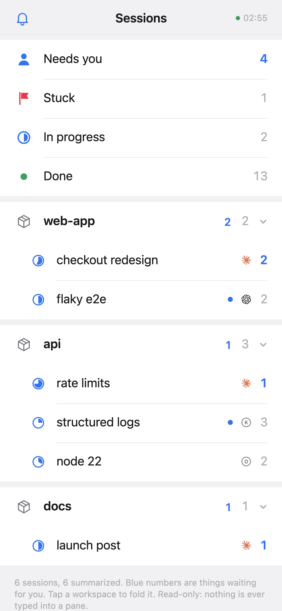
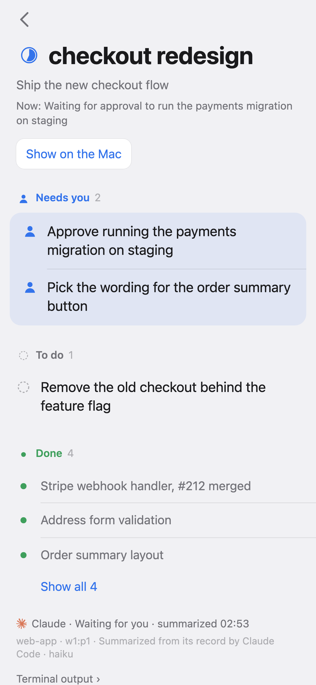
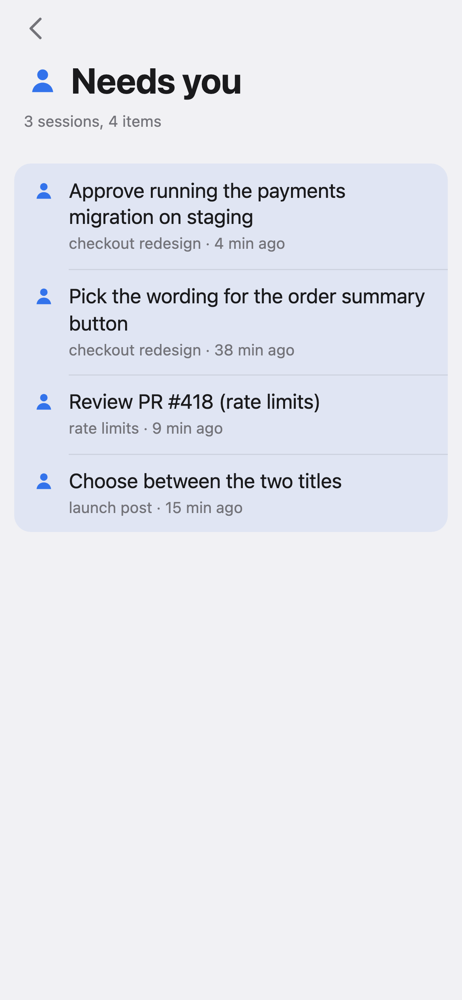

# Herdr Report

You have eight agents running in Herdr and you've stepped away from the Mac.
Which one is waiting on you? Which finished? What was that one in the third
workspace even doing?

Reading terminal output on a phone doesn't answer that. Herdr Report does: for
every agent session, the goal, what's done, what's in progress, what's stuck,
and what needs you, in one list you can check in five seconds.

It's a Herdr plugin. It works with any agent Herdr recognizes, and it gives
the same data to your own tools as an API, an event stream and a JSON file.

<p align="center">
&nbsp;
&nbsp;

</p>
<p align="center"><sub>Made-up sessions from <code>npm run demo</code>.</sub></p>

## Install

Tell your coding agent:

```
Read https://raw.githubusercontent.com/jt-wang/herdr-report/main/SKILL.md and follow it to put my Herdr agents on my phone.
```

It installs the plugin, checks what's missing, and asks you before turning on
anything that costs money. By hand:

```sh
herdr plugin install jt-wang/herdr-report
herdr plugin action invoke check --plugin herdr-report
herdr plugin action invoke start --plugin herdr-report
```

`start` prints an `https://…ts.net` address. Open it on your phone (Tailscale
on, with HTTPS certificates enabled for your tailnet) and add it to the home
screen.

Requires Node 20+. Tested on macOS; the Linux path is there but untested.

## Turn on summaries

Out of the box nothing is summarized, so nothing is spent: you see Herdr's
state for each agent (working, waiting on you, done) and its last words.

For goals, done and to-do lists, a model has to read the sessions. Herdr Report
looks at what you have installed and suggests the cheapest option it has
tested, never the expensive model you write code with:

```sh
herdr plugin action invoke summarizer --plugin herdr-report        # see the suggestion and its cost
herdr plugin action invoke use-recommended --plugin herdr-report   # use it
```

Today it suggests Claude Code or opencode with Haiku, about $0.002 per summary.

Summaries are only made while someone is looking: when you open the page, the
sessions that changed since their last summary are brought up to date, and
while it stays open they follow along (at most every 10 minutes, right away
when an agent starts waiting on you or finishes). Nobody looking, nothing
spent. A session is read in full once; after that only its new part is read.

You can also point it at DeepSeek, OpenRouter, a local model server, or any
command that prints JSON; see [Configuration](#configuration).
[docs/summarizers.md](docs/summarizers.md) has what we measured.

## On the phone

- **Needs you / Stuck / In progress / Done**, across every session.
- **Workspaces** as in Herdr, collapsible, with the number of things waiting on you.
- **A session**: its goal and every item, its last words, and a button that
  switches the Mac to that pane.
- **Notifications** when an agent stops to wait for you, with its last words
  (usually the question it's asking). These come from Herdr and cost nothing,
  so they work even when summaries are off. On iPhone, add the page to the
  home screen first; then turn them on with the bell.
- Updates arrive live. It only reads: it never types into a pane.

## Build on the data

Everything the page shows comes from a small API you can use too:

- `GET /v1/sessions` — every session, with its summary
- `GET /v1/events` — the same, pushed as it changes (server-sent events)
- `sessions.json` in the plugin's config directory, for tools that read files

[docs/api.md](docs/api.md) has the shapes;
[schema/sessions-v1.schema.json](schema/sessions-v1.schema.json) is the contract.

## Configuration

`config.env` in `herdr plugin config-dir herdr-report`. Run the `restart`
action after editing it.

| Key | Default | |
|---|---|---|
| `SUMMARIZER` | `off` | `claude`, `codex`, `opencode`, `openai`, `command` |
| `SUMMARY_MODEL` | — | Model for `claude`, `codex` or `opencode`, e.g. `haiku` |
| `SUMMARY_MODE` | only while someone is looking | `continuous` to keep summarizing with nobody looking |
| `OPENAI_BASE_URL`, `OPENAI_MODEL`, `OPENAI_API_KEY` | — | Any OpenAI-compatible API; the key is optional for local servers |
| `OPENAI_EXTRA_BODY`, `SUMMARY_MAX_TOKENS` | — | Extra request fields, e.g. turning reasoning off |
| `SUMMARIZER_CMD` | — | Reads instructions and text on stdin, prints the JSON |
| `HOST` | `127.0.0.1` | Addresses to listen on; Tailscale publishes it over HTTPS |
| `PORT` | `8794` | |

There is no login. Anyone on your tailnet can read every session and switch
your Mac's focused pane.

## Actions

`check`, `start`, `stop`, `restart`, `status`, `url`, `update`, `summarizer`,
`use-recommended`, `summaries-off`, `uninstall` (removes the service and cache,
keeps `config.env`). An action's output is in `herdr plugin log list --plugin herdr-report`.

## Develop

```sh
npm run demo        # the page with made-up sessions, no Herdr needed
npm test
herdr plugin link . # run your checkout as the plugin
```

No dependencies. `core/` is the data layer, `web/` the page, which reads only
`/v1` like any other client.
